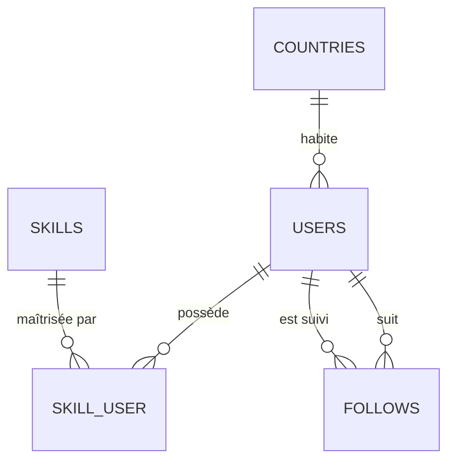
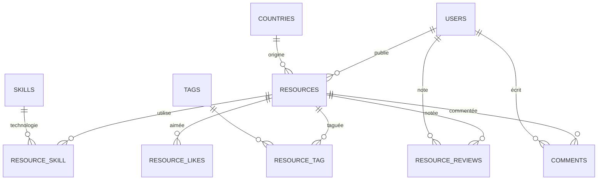
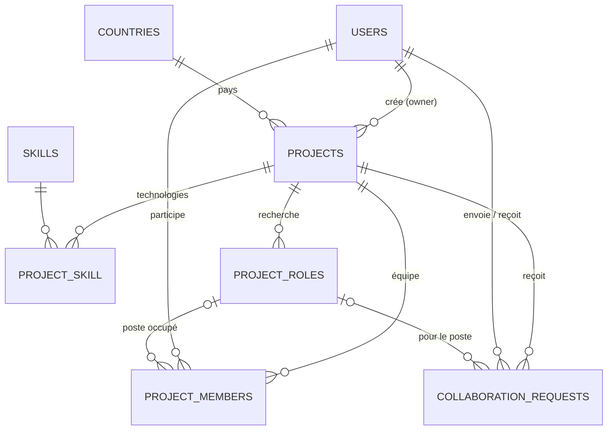
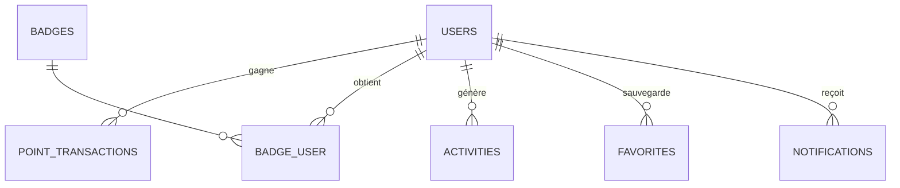
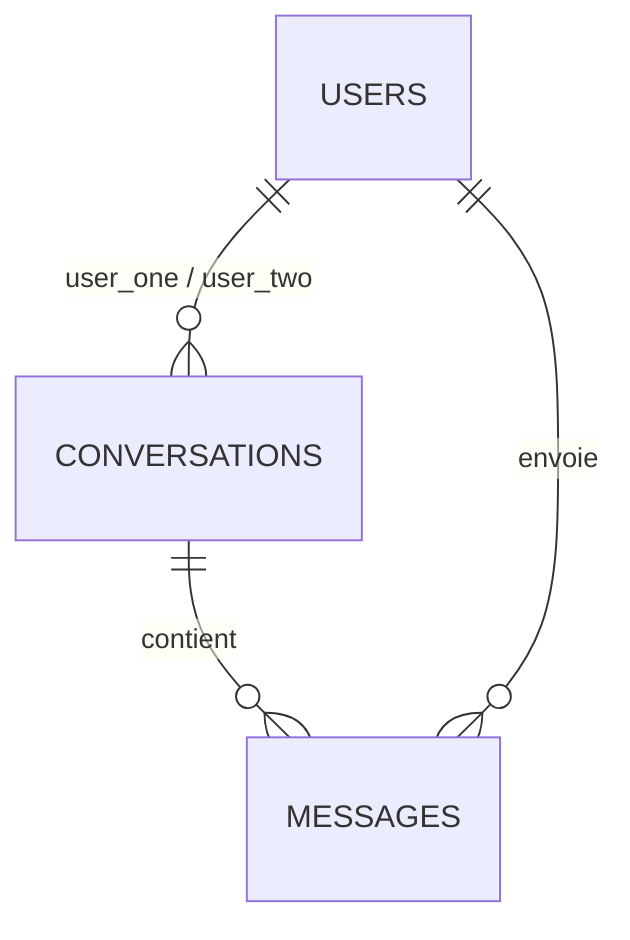

# DevLink Africa — Schéma de la base de données

> Version 1.1 — validée par l'équipe, migrations écrites (`database/migrations/2026_10_10_*`).
> MySQL 8 · InnoDB · utf8mb4. Toutes les tables ont `id`, `created_at`, `updated_at` sauf mention contraire.
>
> **Colonnes « enum »** : stockées en `string` en base et validées par des enums PHP dans `app/Enums/`
> (chaque enum a une méthode `label()` qui donne le libellé français à afficher, ex. `$project->status->label()` → « Recrutement »).
> Ajouter une valeur = modifier l'enum, sans migration.

## Vue d'ensemble

| Domaine | Tables | Fonctionnalités du cahier |
|---|---|---|
| Utilisateurs & profils | `users`, `countries`, `skills`, `skill_user`, `follows` | 1, 2, 3, 4, 5, 23 |
| Ressources | `resources`, `resource_skill`, `tags`, `resource_tag`, `resource_reviews`, `resource_likes`, `comments` | 6, 7 |
| Projets & collaboration | `projects`, `project_skill`, `project_roles`, `project_members`, `collaboration_requests` | 9, 10, 11, 12 |
| Engagement | `point_transactions`, `badges`, `badge_user`, `activities`, `favorites`, `notifications` | 8, 14, 15, 16, 17, 19 |
| Messagerie | `conversations`, `messages` | 13 |
| Modération & IA | `reports`, `ai_searches` | 18, 21, 22 |

---

## 1. Utilisateurs & profils



### `users` (table existante de Breeze, enrichie)

| Colonne | Type | Notes |
|---|---|---|
| name | string | Nom complet affiché (gardé pour Breeze) |
| first_name, last_name | string, nullable | Prénom / Nom |
| username | string, unique | URL du profil public : `/devs/{username}` |
| email, password, email_verified_at, remember_token | — | Breeze |
| avatar_path | string, nullable | Photo |
| country_id | FK → countries, nullable | Pays |
| city | string, nullable | Ville |
| bio | text, nullable | |
| profile_type | enum | `developer`, `designer`, `student`, `data`, `devops`, `product`, `other` |
| experience_level | enum, nullable | `junior`, `intermediate`, `senior`, `expert` |
| availability | enum | `available`, `open`, `busy` (défaut `available`) |
| github_url, linkedin_url, portfolio_url, website_url | string, nullable | Liens |
| devscore | unsigned int, défaut 0 | Total en cache (recalculable depuis `point_transactions`) |
| profile_completed_at | timestamp, nullable | Pour le bonus « Profil complété » (+20) |
| is_public | bool, défaut true | Confidentialité |
| show_email | bool, défaut false | Confidentialité |
| show_availability | bool, défaut true | Confidentialité |
| notify_by_email | bool, défaut true | Préférences de notification : email |
| notify_on_platform | bool, défaut true | Préférences de notification : plateforme |
| is_admin | bool, défaut false | Accès administration |
| suspended_at | timestamp, nullable | Suspension par un admin |

### `countries`
| Colonne | Type | Notes |
|---|---|---|
| name | string | « Guinée » |
| code | char(2), unique | ISO : `GN` |
| flag | string | Emoji 🇬🇳 |
| slug | string, unique | `guinee` |

Pré-remplie par un seeder avec les **54 pays africains**. Pas de `timestamps`.

### `skills`
| Colonne | Type | Notes |
|---|---|---|
| name | string, unique | « Laravel » |
| slug | string, unique | `laravel` |
| category | enum | `backend`, `frontend`, `mobile`, `design`, `devops`, `data`, `database`, `other` |

Pré-remplie (PHP, Laravel, JavaScript, React, Vue, Flutter, Python, Java, Node.js, UI/UX, DevOps, MySQL, PostgreSQL…).

### `skill_user` (pivot)
| Colonne | Type | Notes |
|---|---|---|
| user_id | FK → users | cascade |
| skill_id | FK → skills | cascade |
| level | enum | `beginner`, `intermediate`, `advanced`, `expert` |

Unique (`user_id`, `skill_id`).

### `follows`
| Colonne | Type | Notes |
|---|---|---|
| follower_id | FK → users | celui qui suit |
| followed_id | FK → users | celui qui est suivi |

Unique (`follower_id`, `followed_id`).

---

## 2. Ressources



### `resources`
| Colonne | Type | Notes |
|---|---|---|
| user_id | FK → users | auteur, cascade |
| title | string | |
| slug | string, unique | |
| description | text | |
| type | enum | `api`, `template`, `framework`, `package`, `ui_kit`, `documentation`, `script`, `library`, `open_source` — c'est aussi la « catégorie » du formulaire de publication |
| image_path | string, nullable | |
| file_path | string, nullable | Fichier téléchargeable |
| github_url, demo_url | string, nullable | |
| country_id | FK → countries, nullable | |
| status | enum | `pending`, `approved`, `rejected` — défaut `approved` (publiée directement, l'admin peut retirer) |
| downloads_count | unsigned int, défaut 0 | |
| likes_count | unsigned int, défaut 0 | Compteur en cache |
| rating_avg | decimal(2,1), nullable | Moyenne en cache |
| deleted_at | timestamp, nullable | Suppression douce (admin) |

### `resource_skill` (technologies) · `tags` · `resource_tag`
- `resource_skill` : `resource_id`, `skill_id` — unique.
- `tags` : `name`, `slug` (unique) — tags libres (« auth », « paiement mobile », « mobile money »…).
- `resource_tag` : `resource_id`, `tag_id` — unique.

### `resource_reviews` (notation 1 à 5)
| Colonne | Type | Notes |
|---|---|---|
| resource_id | FK → resources | cascade |
| user_id | FK → users | cascade |
| rating | tinyint | 1 à 5 |
| comment | text, nullable | « Très bonne API pour Laravel. » |

Unique (`resource_id`, `user_id`) : une seule note par personne.

### `resource_likes`
`resource_id`, `user_id`, `created_at` — unique. Un like = « Ressource appréciée » (+5 pour l'auteur).

### `comments`
| Colonne | Type | Notes |
|---|---|---|
| resource_id | FK → resources | cascade |
| user_id | FK → users | cascade |
| body | text | |
| deleted_at | timestamp, nullable | Modération |

---

## 3. Projets & collaboration



### `projects`
| Colonne | Type | Notes |
|---|---|---|
| owner_id | FK → users | créateur, cascade |
| title | string | « AfricaDelivery » |
| slug | string, unique | |
| description | text | |
| category | enum | `fintech`, `healthtech`, `edtech`, `agritech`, `ecommerce`, `logistics`, `social`, `govtech`, `other` |
| country_id | FK → countries, nullable | |
| status | enum | `idea`, `recruiting`, `in_progress`, `completed`, `archived` |
| members_wanted | unsigned tinyint | Nombre de membres recherchés |
| cover_path | string, nullable | Image du projet |
| completed_at | timestamp, nullable | Pour « Projet terminé » (+100) |
| deleted_at | timestamp, nullable | Suppression douce (admin) |

### `project_skill`
`project_id`, `skill_id` — unique. Technologies du projet.

### `project_roles` — « Recruter une équipe »
| Colonne | Type | Notes |
|---|---|---|
| project_id | FK → projects | cascade |
| title | string | « Laravel Developer » |
| skill_id | FK → skills, nullable | Compétence principale (sert à l'IA et à la recherche) |
| slots | unsigned tinyint, défaut 1 | « ×1 » |

### `project_members`
| Colonne | Type | Notes |
|---|---|---|
| project_id | FK → projects | cascade |
| user_id | FK → users | cascade |
| project_role_id | FK → project_roles, nullable | Poste occupé (« Alpha — Laravel ») |
| role | enum | `owner`, `co_owner`, `member` (« promouvoir un membre » = passer en `co_owner`) |
| joined_at | timestamp | |

Unique (`project_id`, `user_id`). Le créateur est ajouté automatiquement avec `role = owner`.

### `collaboration_requests` — demandes **et** invitations
| Colonne | Type | Notes |
|---|---|---|
| project_id | FK → projects | cascade |
| user_id | FK → users | le développeur concerné |
| direction | enum | `application` (le dev demande à rejoindre) · `invitation` (le propriétaire propose depuis un profil) |
| project_role_id | FK → project_roles, nullable | Poste visé |
| message | text, nullable | « Bonjour, j'aimerais rejoindre ton projet… » |
| status | enum | `pending`, `accepted`, `rejected`, `cancelled` |
| responded_at | timestamp, nullable | |

Une seule demande `pending` par (`project_id`, `user_id`) — vérifié dans le code.

---

## 4. Engagement : DevScore, classement, badges, fil, favoris, notifications



### `point_transactions` — historique du DevScore
| Colonne | Type | Notes |
|---|---|---|
| user_id | FK → users | cascade |
| action | enum | `profile_completed` (+20), `project_created` (+50), `resource_published` (+30), `collaboration` (+40), `resource_liked` (+5), `project_completed` (+100) |
| points | int | Peut être négatif (annulation) |
| subject_type, subject_id | morph, nullable | L'objet concerné (projet, ressource…) |
| created_at | timestamp | Pas d'`updated_at` |

**Pourquoi un historique et pas juste un total ?** Le classement doit être filtrable **par mois et par année** : on fait `SUM(points)` sur la période. `users.devscore` garde le total pour l'affichage rapide. Les valeurs des points sont centralisées dans `config/devscore.php` (faciles à ajuster).

### `badges` · `badge_user`
- `badges` : `slug` (unique), `name`, `description`, `icon`, `criteria` (string, ex. `first_project`) — pré-remplie : Premier projet, Expert Laravel, Collaborateur, Contributeur actif, Panafricain, Builder.
- `badge_user` : `user_id`, `badge_id`, `awarded_at` — unique.

### `activities` — fil d'activité
| Colonne | Type | Notes |
|---|---|---|
| user_id | FK → users | auteur de l'action |
| type | enum | `resource_published`, `project_created`, `project_joined`, `badge_earned` |
| subject_type, subject_id | morph | L'objet concerné |
| created_at | timestamp | |

### `favorites` — polymorphe
| Colonne | Type | Notes |
|---|---|---|
| user_id | FK → users | cascade |
| favoritable_type, favoritable_id | morph | `User`, `Resource` ou `Project` |

Unique (`user_id`, `favoritable_type`, `favoritable_id`). Une seule table pour la page « Mes favoris ».

### `notifications`
Table standard de Laravel (`php artisan make:notifications-table`). Gère lu/non lu, et l'envoi par email selon `users.notify_by_email`.

---

## 5. Messagerie (simple, sans temps réel)



- `conversations` : `user_one_id`, `user_two_id` (FK → users, le plus petit id en premier), `last_message_at` — unique (`user_one_id`, `user_two_id`).
- `messages` : `conversation_id`, `sender_id`, `body`, `read_at` (nullable = non lu).

---

## 6. Modération & IA

### `reports` — polymorphe
| Colonne | Type | Notes |
|---|---|---|
| reporter_id | FK → users | |
| reportable_type, reportable_id | morph | `User`, `Resource`, `Project`, `Comment` |
| reason | enum | `spam`, `inappropriate`, `scam`, `illegal`, `other` |
| details | text, nullable | |
| status | enum | `pending`, `resolved`, `dismissed` |
| handled_by | FK → users, nullable | admin |
| handled_at | timestamp, nullable | |

### `ai_searches` — historique DevLink AI (optionnel, utile pour la démo)
| Colonne | Type | Notes |
|---|---|---|
| user_id | FK → users, nullable | |
| query | text | « Je cherche un développeur Flutter en Guinée… » |
| criteria | json | Ce que l'IA a extrait : `{skills, country, project_type}` |
| results | json | Les profils recommandés + % de correspondance |

---

## Décisions prises

1. **Prénom / Nom** : on garde `name` (Breeze, nom affiché) **et** on ajoute `first_name` / `last_name`.
2. **Opportunités** (dans « Favoris ») : laissées de côté pour le MVP.
3. **Ressources** : publiées directement (`approved`), l'admin peut les retirer.
4. **Catégories de projets** : `fintech`, `healthtech`, `edtech`, `agritech`, `ecommerce`, `logistics`, `social`, `govtech`, `other`.
5. **Type de ressource = catégorie** : un seul champ `type`.
6. **Front-end** : Tailwind CSS (installé par Breeze).

---

## Données de démonstration

```bash
php artisan migrate:fresh --seed
```

- **Référence** : 54 pays africains (avec drapeau emoji), 46 compétences, 6 badges.
- **Démo** : ~50 membres répartis dans 16 pays, 11 projets (AfricaDelivery, FinTech Africa, HealthTech Guinea, AgriConnect, EduLink Sahel…), 12 ressources avec notes / likes / commentaires, demandes de collaboration, messages, badges et DevScore étalés sur 6 mois.
- **Comptes** (mot de passe : `password`) :
  - `admin@devlink.africa` — administrateur
  - `alpha.keita@devlink.africa` — propriétaire d'AfricaDelivery
  - `ibrahim.sow@devlink.africa`, `aminata.camara@devlink.africa`, `mamadou.diallo@devlink.africa`…
